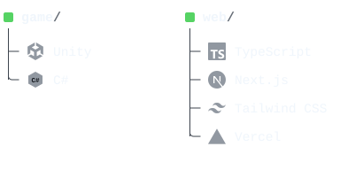
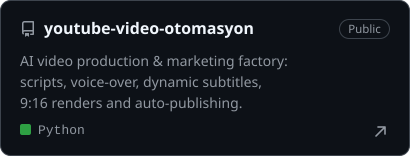
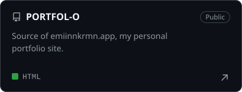

<a href="https://emiinnkrmn.app">
  <picture>
    <source media="(prefers-color-scheme: dark)" srcset="assets/hero-dark.svg">
    <source media="(prefers-color-scheme: light)" srcset="assets/hero-light.svg">
    
  </picture>
</a>

<p align="center">
  <a href="https://emiinnkrmn.app">
    <picture>
      <source media="(prefers-color-scheme: dark)" srcset="assets/portfolio-dark.svg">
      <source media="(prefers-color-scheme: light)" srcset="assets/portfolio-light.svg">
      
    </picture>
  </a>
</p>

### `01` about

```csharp
public sealed class EminKaraman : Engineer
{
    string   Role   => "Computer Engineer";
    string   Focus  => "Unity 3D & C#";
    string[] Builds => ["games", "web apps", "mobile apps", "AI tools"];
    string   Rule   => "clean, optimized code";
    Uri      Home   => new("https://emiinnkrmn.app");
}
```

### `02` stack

<p align="center">
  <picture>
    <source media="(prefers-color-scheme: dark)" srcset="assets/stack-a-dark.svg">
    <source media="(prefers-color-scheme: light)" srcset="assets/stack-a-light.svg">
    
  </picture>
  <picture>
    <source media="(prefers-color-scheme: dark)" srcset="assets/stack-b-dark.svg">
    <source media="(prefers-color-scheme: light)" srcset="assets/stack-b-light.svg">
    
  </picture>
</p>

### `03` projects

<p align="center">
  <a href="https://github.com/parzival6564-ai/youtube-video-otomasyon">
    <picture>
      <source media="(prefers-color-scheme: dark)" srcset="assets/project-video-factory-dark.svg">
      <source media="(prefers-color-scheme: light)" srcset="assets/project-video-factory-light.svg">
      
    </picture>
  </a>
  <a href="https://github.com/parzival6564-ai/PORTFOL-O">
    <picture>
      <source media="(prefers-color-scheme: dark)" srcset="assets/project-portfolio-dark.svg">
      <source media="(prefers-color-scheme: light)" srcset="assets/project-portfolio-light.svg">
      
    </picture>
  </a>
</p>

### `04` activity

<picture>
  <source media="(prefers-color-scheme: dark)" srcset="https://raw.githubusercontent.com/parzival6564-ai/parzival6564-ai/refs/heads/output/snake-dark.svg">
  <source media="(prefers-color-scheme: light)" srcset="https://raw.githubusercontent.com/parzival6564-ai/parzival6564-ai/refs/heads/output/snake-light.svg">
  
</picture>

<p align="center"><sub>Redrawn every day from my real contribution calendar by <a href="scripts/contrib-snake.mjs">scripts/contrib-snake.mjs</a>. No third-party service, no token.</sub></p>
