<div align="center">



<br/><br/>

<a href="https://emiinnkrmn.app/"></a>

</div>

<br/>

```ts
const emin = {
  name: "Emin Karaman",
  role: "Computer Engineer",
  builds: ["games", "web apps", "mobile apps", "AI tools"],
  principle: "clean, optimized code",
  stack: {
    game:    ["Unity", "C#"],
    mobile:  ["Flutter", "Dart"],
    web:     ["TypeScript", "Next.js", "Tailwind", "Supabase"],
    scripts: ["Python", "PowerShell"],
  },
  portfolio: "https://emiinnkrmn.app",
} as const;
```

<br/>

<div align="center">

<h3>stack</h3>


<br/><br/>

<h3>projects</h3>

<table>
  <tr>
    <td align="left" valign="top" width="360">
      <b><a href="https://github.com/parzival6564-ai/youtube-video-otomasyon">youtube-video-otomasyon</a></b><br/>
      <sub>AI video production &amp; marketing factory: scripts, voice-over, dynamic subtitles, 9:16 renders, auto-publish.</sub><br/>
      <sub><code>Python</code></sub>
    </td>
    <td align="left" valign="top" width="360">
      <b><a href="https://emiinnkrmn.app/">emiinnkrmn.app</a></b><br/>
      <sub>Personal portfolio site.</sub><br/>
      <sub><code>HTML</code> &middot; <a href="https://github.com/parzival6564-ai/PORTFOL-O">source</a></sub>
    </td>
  </tr>
</table>

<sub>New games, web and mobile apps are in the works.</sub>

<br/><br/>

<h3>contributions</h3>

<picture>
  <source media="(prefers-color-scheme: dark)" srcset="https://raw.githubusercontent.com/parzival6564-ai/parzival6564-ai/refs/heads/output/github-snake-dark.svg">
  <source media="(prefers-color-scheme: light)" srcset="https://raw.githubusercontent.com/parzival6564-ai/parzival6564-ai/refs/heads/output/github-snake.svg">
  
</picture>

<br/><br/>

<code>while (alive) { learn(); build(); ship(); }</code>

</div>
